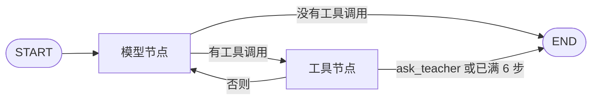

# 智教 Harness MVP 路线

状态：已确认（2026-10-21，运行时改为 LangGraph）

决策：运行时使用 LangGraph 的 `StateGraph`。图上只有模型节点和工具节点，以及从模型节点出发的条件边。工具经注册表接入，schema 在每次模型请求时投影。新能力登记为工具，不改节点和边。不使用预置 ReAct。不把 DeepSeek Harness 当作依赖。

配套文档：[后续路线](2026-10-21-later-roadmap.md)

本文决定 MVP 的产品范围、图、工具、状态、产物协议、错误处理和验收。后端语言定为 Python 3.10 及以上，因为 LangGraph 是 Python 包。本文不选定 Web 框架、数据库产品和模型供应商。仓库里还没有业务代码。未选定 Web 框架之前，不新建 `backend/` 或 `frontend/` 的空骨架。

## 1. 产品

教师用自然语言描述一节课要做的事。系统把这句话当作一轮对话交给模型。模型通过已注册的工具完成选择和生成。校验通过的文件才成为可预览的版本。教师再用一句话修改，成功则产生新版本。

随机点名器、课堂计时器、课堂投票器是 `use_preset` 里的三份模板，不是三条独立管道。对不上模板的需求，由模型调用 `write_page` 写出新的自包含网页。

MVP 面向单教师、本机使用。进程即信任边界，没有登录、没有学校组织、没有多人实时课堂。

## 2. 运行时

一张编译好的 LangGraph `StateGraph` 处理所有任务。一轮（turn）对应教师的一条消息，也对应一个任务。一步（step）是一次模型请求，加上这次回复里的那一个工具调用。进程启动时编译一次。每个任务调用一次 `invoke`，不使用流式。



`invoke` 返回之后，执行器才发布或失败。图里的节点不写版本行。

这一轮的图状态：

| 字段 | 合并 |
| --- | --- |
| `messages` | 追加本轮的助手消息和工具结果。不在这里存放上一版网页正文 |
| `candidate` | 替换。校验通过的新候选盖过旧候选 |
| `step_count` | 每收到一次模型响应加一 |
| `stop` | 替换。空、`ask_teacher`，或模型错误 |

不使用 `add_messages` 把整页 HTML 追加进历史。上一版文件由拼装模块从已发布版本读取，并按第 12 节截断。工具结果只写校验结论和错误，不把页面正文再写进 `messages`。

节点与边：

- 模型节点调用第 12 节的 `complete`，把注册表投影放进 `tools`。返回后写入 `assistant_message`，`step_count` 加一。
- 条件边只看刚返回的助手消息：没有工具调用就到 `END`；有工具调用就到工具节点。
- 工具节点在恰好一个调用、名字在注册表里、参数符合 schema 时执行，并写入 `tool_result`。否则一个都不执行，写入说明原因的 `tool_result`。
- 工具节点默认回到模型节点。`ask_teacher` 执行后丢弃 `candidate`，`stop` 设为 `ask_teacher`，走到 `END`。`step_count` 已经是 6 时，工具执行完也走到 `END`，不再发下一次模型请求。

`invoke` 的 `recursion_limit` 设为 20，只作为图本身的保险丝。产品上的停机以 6 步为准。节点不设置 LangGraph 的 `RetryPolicy`。超时重试只发生在 `complete` 内部的那一次。

编译时不传入检查点（checkpointer）。不使用 `interrupt`。进程崩溃后不能从半步恢复；任务按第 5 节标成 `interrupted`。对外进度只在任务表和会话事件里。不另建 thread id。若以后启用检查点，`thread_id` 必须等于 `task_id`。

依赖 `langgraph`。它会安装 `langchain-core`。业务代码不调用 `create_agent`、`create_react_agent`，也不使用 `langgraph.prebuilt.ToolNode`，因为后者会并行执行同一步里的多个工具调用。不开启 LangSmith：不设置 `LANGCHAIN_TRACING_V2`、`LANGSMITH_TRACING` 或对应的密钥。

不采用的部分：

- 不把 DeepSeek Harness 或 Cordis 当作依赖，不引入事件总线、插件热加载和子代理。
- 不向模型提供 Shell、Python、SQL、读任意路径或外网工具。模型生成的页面只作为数据文件。后端本身使用 Python。
- 不把校验和发布做成模型可以跳过的工具。发布由执行器在 `invoke` 返回后提交。

## 3. 模块

前后端分离的模块化单体。一个 Python 后端进程提供 API，并在进程内 `invoke` 这张图。不引入消息队列、微服务、第二套任务状态。目录以 [架构目录](../../architecture.md) 为准。

| 模块 | 职责 | 依赖 | 不做 |
| --- | --- | --- | --- |
| 工作台 | 输入需求、轮询状态、隔离预览、提交修改、导出 | API | 调用模型、拼接存储路径、把生成页插入主文档 |
| API | 校验请求、创建任务、返回统一响应、提供预览和导出 | 图、存储 | 组装提示词、执行工具 |
| 图 | 步数、停机、候选文件。`invoke` 返回后由执行器发布或失败 | 注册表、拼装、模型适配、存储 | 某个工具的页面细节、写版本行 |
| 工具注册表 | 保存工具定义，并投影出模型可见的 schema | 各工具的登记 | 决定本轮调用哪个工具 |
| 上下文拼装 | 系统提示词、教师文本、本轮已发生的消息、工具 schema | 注册表、会话日志、已发布版本 | 调用模型、读取注册表以外的路径 |
| 模型适配 | 按统一协议发送消息和工具 schema，返回助手消息或错误 | 环境配置中的密钥 | 选择工具、发布版本 |
| 校验器 | 文件清单、结构、类型、大小、路径和安全规则 | 产物协议 | 前端组件、把失败改成成功 |
| 预览 | 按已发布版本读文件，加上隔离响应头 | 存储 | 在后端执行页面脚本 |
| 存储 | 任务、会话事件、产物、版本、文件 | 本地数据库与文件目录 | 用用户输入拼接路径 |

`use_preset` 和 `write_page` 是注册表里的两项。它们调用校验器，不自己发布版本，也不实现任务管理和用户管理。

## 4. 一轮怎么走

创建：

1. 工作台提交原文，可带可选的 `preset_hint`（`roll-call`、`timer` 或 `poll`）。
2. API 校验原文长度后创建任务，状态 `pending`，立刻返回 `task_id`。
3. 执行器把状态改为 `running`。工作台轮询 `GET /api/tasks/{task_id}`。
4. 执行器调用已编译的图。模型节点拼装本轮消息和工具 schema，调用模型。
5. 条件边看到工具调用：工具节点按第 7 节执行或拒绝，把结果写入会话，再回到模型节点。
6. 没有工具调用，或工具节点因 `ask_teacher`、步数用尽走到 `END`：`invoke` 返回。
7. 执行器读取返回状态。有一份校验通过的候选则发布为新版本，任务 `succeeded`。没有候选则任务 `failed`，已有版本不变。

修改：

1. 工作台对某个已发布版本提交修改说明。
2. API 确认该版本存在，创建新任务，记上 `base_artifact_id` 和 `base_version`。
3. 这一轮的用户消息里包含修改说明，以及该版本的文件。模型再调用工具。
4. 成功则版本号为当前最高版本加一。指定修改版本 1 时，不会把版本 2 盖掉；新版本仍是最高版本加一。失败则教师继续看到修改前的版本。

导出只打包被请求的已发布版本。预览用 iframe 打开该版本入口，响应带第 13 节的头。主应用不把页面 HTML 插入自己的 DOM。

## 5. 任务状态

全项目只在一处定义这个枚举。工作台、API 和图引用同一份。LangGraph 的节点内部状态不对外暴露。

| 状态 | 含义 |
| --- | --- |
| `pending` | 已接收，图尚未开始 |
| `running` | 本轮正在进行，可能已经有过工具调用 |
| `succeeded` | 本轮已发布恰好一个版本 |
| `failed` | 本轮没有发布版本 |

合法转换：

- `pending` → `running` → `succeeded`
- `pending` → `running` → `failed`
- 请求非法时，API 直接返回错误，不创建任务。创建之后若在 `invoke` 之前失败，任务写成 `failed`。

`succeeded` 和 `failed` 是终态。修改是新任务。

禁止：

- 从 `running` 以外的状态发布版本
- 一个任务发布两个版本
- 把未校验的候选或失败任务的临时文件标成版本
- 为工具调用再增加「解析中」「生成中」等对外状态。这些过程记在第 6 节的会话事件里

执行器崩溃，或 `running` 超过 10 分钟没有新的会话事件：任务改为 `failed`，错误类别 `interrupted`，候选丢弃。不自动重跑。

## 6. 会话事件

一个任务有一条按顺序追加的事件日志。事件类型只有：

| 类型 | 何时写入 |
| --- | --- |
| `user_message` | 本轮开始，内容是拼装后的教师侧文本 |
| `assistant_message` | 模型返回后，含文本和工具调用 |
| `tool_result` | 工具执行完，含成功或失败的文本结果 |
| `artifact_published` | 本轮结束并成功发布时写一条 |

日志不记录密钥、完整系统提示词和工具 schema。名单若出现在工具参数里，留在该任务的事件里供排错，不进入应用日志。

轮询接口返回状态、错误、步数、最后一个事件的类型。不返回文件正文。

## 7. 工具注册

工具定义包含：

- `name`
- 给模型看的 `description`
- 参数的 JSON Schema
- `execute(arguments, turn) -> text`

`execute` 只返回文本。它不能改任务状态，不能把文件移到正式版本目录。发布由执行器在 `invoke` 返回后做。

模型看不见 `execute`。请求里的工具清单只含 `name`、`description` 和参数 schema。

一步只执行一个工具调用。模型一次返回多个调用时，一个都不执行，工具结果说明「一步只能调用一个工具」，这一步仍然计入 6 步上限。

未知工具名：不执行，结果说明该名字不在注册表里。

参数不符合 schema：不执行，结果写出 schema 错误。

MVP 注册且只注册这三个工具：

| 工具 | 参数 | 执行 |
| --- | --- | --- |
| `use_preset` | `preset`：`roll-call`、`timer`、`poll`。以及 `title`、可选的 `duration_seconds`、`names`、`options`、`constraints` | 用仓库里的模板渲染文件，再交校验器。通过则替换本轮候选 |
| `write_page` | `title`，`files[]` 的 `path` 和 `content` | 把文件交给校验器。通过则替换本轮候选 |
| `ask_teacher` | `question`，1 到 500 字 | 丢弃候选，本轮立刻以 `failed` / `needs_clarification` 结束，不再调用模型 |

`use_preset` 的缺省：计时器时长 300 秒；投票没有选项时用「A」「B」；点名没有名单时页面提供本地输入，不编造姓名。`constraints` 是字符串列表，例如「大字」「不要音效」。

教师请求里带了 `preset_hint` 时，它只出现在用户消息里。系统提示词要求模型在该提示与原文一致时调用对应的 `use_preset`。模型仍可以改调用 `write_page` 或 `ask_teacher`。图不因为提示不符合而改写工具调用。产物记录实际执行并形成候选的工具名。

注册表在进程启动时固定，并在编译图之前装入工具节点。测试可以构造一份多一个工具的注册表来编译图，生产路径不从请求里加载工具。

新增一个工具的要求：实现 `execute`，把它放进注册表，补一份工具参数测试。图的节点和边、任务状态和发布规则保持不动。做不到这一点，就不算可扩展。

## 8. 预置模板

模板是仓库里人工编写的 HTML、CSS 和脚本。模型只通过 `use_preset` 提供参数。文本插入使用转义或文本节点。

三份模板都要：

- 浏览器直接打开 `index.html` 就能用
- 适合投影：字号大、对比清楚、主要操作一个按钮能完成
- 不依赖外网、字体 CDN 和构建步骤
- 不读取主应用的存储，不请求后端

点名器 `roll-call`：

- 有名单时，每次点击随机抽出尚未点过的名字；抽完可重置
- 无名单时，页面提供本地文本框。名单留在浏览器里
- 参数里的名单只写入该版本文件

计时器 `timer`：

- 默认 300 秒，页面上可以改时长
- 开始、暂停、重置
- 结束时有明显的视觉变化。音效默认关闭，`constraints` 里写了需要音效才开启

投票器 `poll`：

- 至少两个选项，页面上可以改选项文字
- 点击计票。计数留在浏览器里，不写回服务器
- 可以清空本机计数

## 9. write_page

`write_page` 产出新的自包含互动网页。文件是数据，后端不执行其中的脚本，不根据它启动进程。

约束：

- 入口是 `index.html`。允许同目录的 CSS、脚本和图片，不允许需要编译的工程
- 脚本和样式内联，或使用同版本相对路径。禁止外链脚本、外链样式和网络请求
- 页面状态用自身变量或 `localStorage`。键名带产物 id
- 单个文件不超过 500 KB，合计不超过 2 MB
- UTF-8
- 文件内容里不放密钥、服务器路径和系统提示词

修改时，上一版文件已经在用户消息里。模型调用 `write_page` 提交完整的新文件。做不到语句级补丁时，允许整页重写。候选未通过校验则不会替换上一份已发布版本。

## 10. 校验

校验器由 `use_preset` 和 `write_page` 调用。它不修改文件来凑合通过。

通过条件：

- 文件清单与实际内容一致，且非空
- 恰好一个 `index.html`
- 路径是相对路径，没有 `..`、绝对路径、空段和反斜杠
- 媒体类型是 `text/html`、`text/css`、`text/javascript`、`image/png`、`image/jpeg`、`image/svg+xml`、`image/webp`、`image/gif` 之一
- 大小符合第 9 节
- HTML 能被解析，并含有可显示的正文
- 没有外链脚本、外链样式、`http:` 或 `https:` 资源
- 没有要在后端执行的代码块

通过：工具结果写「校验通过，本轮结束且没有新的工具调用时会发布」。这份文件成为本轮候选，替换之前的候选。临时目录保留到本轮结束。

不通过：工具结果写明失败项。候选若已存在则保留上一份候选，本轮继续，直到步数用尽或模型停止。临时的失败文件删除。

校验通过只说明结构和安全规则通过。交互是否好用由预览确认。MVP 不自动点击页面里的按钮。

## 11. 发布

一轮最多发布一个版本。版本从 1 递增，只有本轮结束时的那一次提交才占用版本号。

结束时的规则：

| 情况 | 结果 |
| --- | --- |
| 没有工具调用，且有候选 | 发布候选，`succeeded` |
| 没有工具调用，且没有候选 | `failed`，`no_artifact` |
| 调用了 `ask_teacher` | 丢弃候选，`failed`，`needs_clarification`，消息用工具参数里的 `question` |
| 已满 6 步，最后一步执行完仍有工具调用 | 不再调用模型。有候选则发布，否则 `failed`，`step_limit` |
| 模型超时、上游错误、存储失败、执行器中断 | 丢弃候选，`failed`，使用对应错误类别 |

6 步里的一步包含一次模型响应。只返回工具调用、参数又不合法的响应也计一步。

发布在一个事务里写入版本行，并把候选目录换成正式路径 `{根目录}/{artifact_id}/{version}/`。事务失败则任务 `failed`，`storage_failed`，正式路径不变。

## 12. 模型接入与上下文

### 12.1 适配

```text
complete(messages, tools) ->
  assistant{content, tool_calls}
  | timeout
  | upstream
  | empty
```

`messages` 的 `role` 只使用 `system`、`user`、`assistant`、`tool`。`tools` 是注册表的投影。`tool_calls` 里每一项有 `id`、`name` 和 JSON 对象参数。

传输用 Chat Completions 兼容协议：`POST {LLM_BASE_URL}/chat/completions`。正文含 `model`、`messages`、`tools`、`temperature`、`max_tokens`，`stream` 为 false。`temperature` 为 0.2。`max_tokens` 为 8000，因为 `write_page` 的参数里包含页面正文。

只读取第一条候选的 `content` 和 `tool_calls`。供应商若要求工具调用走另一套字段，适配层在返回前归一成上面的结构。业务代码不引用供应商 SDK。

| 变量 | 含义 |
| --- | --- |
| `LLM_BASE_URL` | 服务根地址 |
| `LLM_API_KEY` | 密钥。缺失时进程拒绝启动 |
| `LLM_MODEL` | 模型名 |
| `LLM_TIMEOUT_SECONDS` | 缺省 60 |

单次 `complete` 超时、连接失败或无法读出助手消息时，用同一组消息再试 1 次。仍失败则本轮 `failed`，类别 `model_timeout` 或 `model_invalid_output`。上游 HTTP 错误不重试，类别 `model_upstream`。不把失败的响应正文塞回会话。

不流式返回。工作台只看见任务状态和步数。

### 12.2 拼装

拼装模块是唯一组装模型输入的地方。每一跳都重新组装，不在各工具里拼接提示词。

系统消息来自进程启动时读入的 `prompts/system.md`。文件说明：面向教师的课堂工具、一步一个工具、页面必须自包含、不能要求执行服务器命令。信息足够时通过 `use_preset` 或 `write_page` 留下校验通过的页面；关键信息不足时调用 `ask_teacher`。工具名单不写死在这个文件里，名单以当次请求的 `tools` 为准。

第一条用户消息按这个顺序包含存在的块：

1. `teacher_request` 或 `revision`
2. 可选的 `preset_hint`
3. 修改时，每个已发布文件一块 `previous_file`

随后按会话事件附上本轮已经发生的助手消息和工具结果。

块用标记包住。教师文本和文件内容里的 `</` 先替换成 `<\/`。系统提示词把标记内的文字当数据。

不放进输入的内容：其他任务的会话、其他产物、服务器路径、环境变量、检索材料、上一次 HTTP 失败的原文。

| 块 | 上限 | 超出时 |
| --- | --- | --- |
| `prompts/system.md` | 4000 字 | 进程启动失败 |
| 全部工具的 description 与 schema | 4000 字 | 进程启动失败 |
| `teacher_request`、`revision` | 4000 字 | API 拒绝创建任务 |
| 单个 `previous_file` | 12000 字 | 保留开头 8000 和结尾 4000，中间写一行 `[...truncated...]` |
| 修改时的文件合计 | 20000 字 | 先保留 `index.html`，其余按路径名排序省略，并在用户消息末尾列出台省略的路径 |

## 13. 产物、预览与导出

一份产物在多次修改中保持同一个 `artifact_id`。列表接口返回：

```text
artifact_id
artifact_type        MVP 固定 interactive-page
title
version              当前最高已发布版本
tool_name            use_preset 或 write_page
preset               仅 use_preset 时有值
files[]              相对路径、媒体类型、角色 entry 或 asset
metadata             任务 id、标题，不含密钥和绝对路径
capabilities         preview, revise, export
```

形成候选的那次工具参数保存在版本记录里。列表和轮询不返回 `names`。

预览响应头：

- `Content-Security-Policy: default-src 'none'; style-src 'unsafe-inline'; script-src 'unsafe-inline'; img-src data: blob:; connect-src 'none'; base-uri 'none'; form-action 'none'`
- `X-Content-Type-Options: nosniff`
- 入口文档 `Content-Type: text/html; charset=utf-8`

iframe 使用 `sandbox="allow-scripts"`，不授予 `allow-same-origin`、`allow-top-navigation`、`allow-popups`。查询参数里不放会话令牌。

导出是该版本文件的 zip，外加 `manifest.json`（`artifact_id`、`version`、`title`、`tool_name`、`files`）。不含绝对路径和事件日志。

## 14. API

前缀 `/api`。

| 方法 | 路径 | 行为 |
| --- | --- | --- |
| `POST` | `/api/tasks` | `raw_request` 必填，1 到 4000 字；`preset_hint` 可选。返回 `task_id` 和 `pending` |
| `GET` | `/api/tasks/{task_id}` | 状态、步数、最后事件类型、错误、成功时的 `artifact_id` 和 `version` |
| `POST` | `/api/artifacts/{artifact_id}/versions/{version}/revisions` | `instruction` 必填，1 到 4000 字。仅已发布版本。返回新的 `task_id` |
| `GET` | `/api/artifacts/{artifact_id}` | 第 13 节的字段和版本列表 |
| `GET` | `/api/artifacts/{artifact_id}/versions/{version}/preview/` | 该版本入口和相对资源 |
| `GET` | `/api/artifacts/{artifact_id}/versions/{version}/export` | 该版本的 zip |

```text
error.code
error.message     教师能看懂的下一步，不含堆栈、绝对路径、密钥、提示词
error.retryable
```

| `error.code` | 何时 | 可重试 |
| --- | --- | --- |
| `invalid_input` | 原文为空、超长、版本号或 `preset_hint` 非法 | 否 |
| `not_found` | 任务、产物或版本不存在 | 否 |
| `needs_clarification` | 模型调用了 `ask_teacher` | 否，教师补充后重新提交 |
| `no_artifact` | 模型停止，且本轮没有候选 | 是 |
| `step_limit` | 满 6 步仍没有候选 | 是 |
| `model_timeout` | 同一步的调用两次都超时或连接失败 | 是 |
| `model_invalid_output` | 同一步两次都读不出助手消息 | 是 |
| `model_upstream` | 供应商返回错误 | 是 |
| `interrupted` | 执行器中断或 `running` 超时 | 是 |
| `storage_failed` | 发布事务失败 | 是 |
| `internal` | 未分类异常 | 是 |

工具参数错误和校验失败先作为 `tool_result` 回到模型，不立刻把任务写成 `failed`。只有本轮按第 11 节结束且没有发布时，才使用 `no_artifact` 或 `step_limit`。

进行中的任务禁止重复提交。轮询间隔建议 1 秒，终态后停止。

## 15. 存储与运行

一个 Python 后端进程接受 API，并在进程内 `invoke` 这张图。任务状态以数据库为准。图状态只活在这一次 `invoke` 里，不另存一份检查点。

表至少包括：任务、会话事件、产物、版本。文件在文件系统。候选留在临时目录，发布成功后才进入正式路径。

不使用 Redis、Celery 或独立 worker。不建用户表，不留空的 `user_id`。账号是后续路线的迁移。

## 16. 三步交付

前一步验收通过，再做下一步。

### 第 1 步：图能注册工具

用假的 `complete` 驱动模型节点。假模型对点名夹具返回一次 `use_preset`，然后返回没有工具调用的消息。

交付：

- 四态任务、会话事件、注册表、`StateGraph`、校验器、存储和预览
- `use_preset` 的点名器模板
- 测试用注册表可以多登记一个不生产使用的工具

验收：

- 夹具跑到 `succeeded`，预览里能抽名字
- 校验失败的 `use_preset` 产生 `tool_result`，假模型下一跳不再调用工具时，任务 `failed`，没有版本行
- 多登记一个工具后，图的节点和边不需要修改；假模型调用它时能得到结果
- 预览响应带第 13 节的 CSP，页面不在主应用 DOM 里
- 这一步不开放依赖真实模型的创建接口。工作台能打开已发布预览即可

### 第 2 步：模型自己调用工具

交付：

- 第 12 节的适配和 `prompts/system.md`
- `write_page`、`ask_teacher`
- 计时器和投票器模板
- `POST /api/tasks`

验收：

- 「做一个抽签决定哪一组先发言的转盘」由模型调用 `write_page`，得到可预览页面
- 「随机点名」由模型调用 `use_preset`，`preset` 为 `roll-call`
- 第一次 `write_page` 校验失败时，任务仍是 `running`，下一次模型输入里能看到失败原因；随后的合法调用可以发布
- 模型调用 `ask_teacher` 时任务 `failed`，`needs_clarification`，没有版本
- 假模型返回未知工具名或两个工具调用时，它们不被执行
- 第 7 次模型请求不会发出

### 第 3 步：修改、版本、导出

交付：修改任务、版本递增、zip 导出。三份模板和 `write_page` 都能作为修改基线。

验收：

- 对已发布页面说「把按钮文字改成开始抽签」，成功后版本为 2，版本 1 仍可打开
- 这一轮的用户消息含版本 1 的 `index.html` 和修改说明
- 修改任务最终没有候选时，已发布版本仍是修改前的那一版
- 导出的 zip 只含被请求的版本，其中的 `index.html` 与预览一致

## 17. 完成标准

三步都通过，并且有测试覆盖：

- 假模型的工具调用按注册表执行，未知工具和多重调用不执行
- 新增工具不需要修改图的节点和边
- 节点没有 `RetryPolicy`，编译没有检查点，追踪环境变量保持关闭
- 校验失败会回到会话，而不会发布
- 无候选的结束是 `failed`，不会标成成功
- 失败的修改不覆盖上一成功版本
- 步数不超过 6
- 状态只按第 5 节转换
- 缺文件、错误媒体类型、非法路径被拒绝
- 导出与该版本一致
- 工作台有等待、进行、成功、失败，进行中不能重复提交
- 预览不把生成内容插入主应用 DOM
- 消息中不出现密钥和绝对路径；过长的上一版 HTML 含截断标记

测试使用虚构课堂数据。单元测试不访问真实供应商。

## 18. 规范同步

`AGENTS.md` 的 MVP 描述、模块边界和任务状态已改为与本文一致。`.cursor/rules/30-harness.mdc` 的主流程改为这张图和工具注册表。`.cursor/rules/40-testing.mdc` 的必测场景改为工具调用和四态。

后端语言是 Python，运行时是 LangGraph `StateGraph`。目录见 [架构目录](../../architecture.md)。Web 框架只进 `backend/app/main.py`，数据库驱动只进 `backend/app/storage/`。选定这两样之后，补进第 3 节，不搬目录。不再评估用另一套循环替换这张图。

## 19. 本文不做的事

后续工具、检索、队列和明确不做的清单在[后续路线](2026-10-21-later-roadmap.md)。MVP 不预建那些工具。
