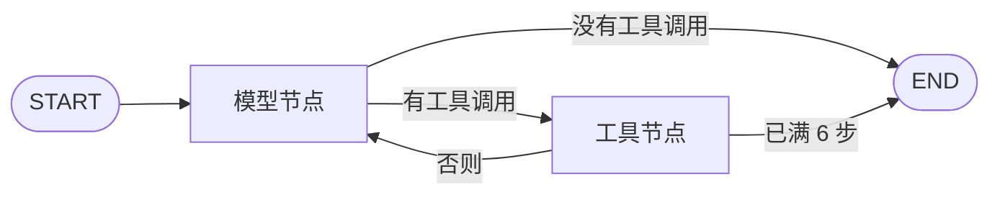

# 智教 Harness MVP 路线

状态：已完成（2026-10-22）。规格于 2026-10-21 确认为先做对话。本文范围不再扩大。

决策：MVP 先做教师与智能体的多轮对话。运行时仍是 LangGraph 的 `StateGraph`，图上保留模型节点、工具节点和条件边。生产注册表为空，不要求模型调用工具。注册表、条件边和 `tool_result` 是预留：测试可以登记一个不面向教师的工具，用来证明加工具不用改图。不实现随机点名器、课堂计时器、课堂投票器，也不实现 `use_preset`。不使用预置 ReAct。不把 DeepSeek Harness 当作依赖。

配套文档：[后续路线](2026-10-21-later-roadmap.md)、[架构目录](../../architecture.md)

本文决定 MVP 的产品范围、对话、图、状态和验收。后端语言是 Python 3.10 及以上。Web 框架是 FastAPI，只出现在 `backend/app/main.py`。数据库是 Python 标准库 `sqlite3`，只出现在 `backend/app/storage/`。

## 1. 产品

教师在一个会话里用自然语言和智能体交谈。每一条教师消息是一轮。模型返回文字回复后，这一轮成功。教师可以接着问。下一轮的模型输入包含本会话里已经成功的对话。

MVP 不生成网页，不预览，不导出，不发布版本。网页和其它产物留到后续，等第一个真正的工具登记之后。

MVP 面向单教师、本机使用。进程即信任边界，没有登录、没有学校组织、没有多人实时课堂。

## 2. 运行时

一张编译好的 LangGraph `StateGraph` 处理所有轮次。一轮（turn）对应教师的一条消息，也对应一个任务。进程启动时编译一次。每个任务调用一次 `invoke`，不使用流式。



生产路径上注册表为空，请求不带 `tools`。正常的一轮只有一次模型响应：没有工具调用，且回复正文非空，然后到 `END`。

这一轮的图状态：

| 字段 | 合并 |
| --- | --- |
| `messages` | 追加本轮的助手消息。注册表里真有工具时，也追加工具结果 |
| `step_count` | 每收到一次模型响应加一 |
| `stop` | 替换。空，或模型错误 |

MVP 的图状态没有候选文件，节点也不写版本行。发布留到有工具真正产出文件的阶段。

节点与边：

- 模型节点调用第 8 节的 `complete`。注册表非空时，才把投影放进 `tools`。返回后写入 `assistant_message`，`step_count` 加一。
- 条件边只看刚返回的助手消息：没有工具调用就到 `END`；有工具调用就到工具节点。
- 工具节点在恰好一个调用、名字在注册表里、参数符合 schema 时执行，并写入 `tool_result`，然后回到模型节点。否则一个都不执行，写入说明原因的 `tool_result`，再回到模型节点。
- `step_count` 已经是 6 时，工具节点执行完走到 `END`，不再发下一次模型请求。

`invoke` 的 `recursion_limit` 设为 20，只作为图本身的保险丝。产品上的停机以 6 步为准。节点不设置 LangGraph 的 `RetryPolicy`。超时重试只发生在 `complete` 内部的那一次。

编译时不传入检查点（checkpointer）。不使用 `interrupt`。进程崩溃后不能从半步恢复；任务按第 5 节标成 `interrupted`。对外进度只在任务表和会话事件里。不另建 thread id。若以后启用检查点，`thread_id` 必须等于 `task_id`。

依赖 `langgraph`。它会安装 `langchain-core`。业务代码不调用 `create_agent`、`create_react_agent`，也不使用 `langgraph.prebuilt.ToolNode`。不开启 LangSmith：不设置 `LANGCHAIN_TRACING_V2`、`LANGSMITH_TRACING` 或对应的密钥。

不采用的部分：

- 不把 DeepSeek Harness 或 Cordis 当作依赖，不引入事件总线、插件热加载和子代理。
- 不向模型提供 Shell、Python、SQL、读任意路径或外网工具。后端本身使用 Python。
- 生产注册表不放入任何面向教师的工具。点名、计时、投票不在注册表里，也不作为模板目录存在。

## 3. 模块

前后端分离的模块化单体。一个 Python 后端进程提供 API，并在进程内 `invoke` 这张图。不引入消息队列、微服务、第二套任务状态。目录以 [架构目录](../../architecture.md) 为准。

| 模块 | 职责 | 依赖 | 不做 |
| --- | --- | --- | --- |
| 工作台 | 打开会话、输入消息、轮询、显示回复 | API | 调用模型、预览生成页、导出 |
| API | 校验请求、创建会话和任务、返回统一响应 | 图、存储 | 组装提示词、执行工具 |
| 图 | 步数、停机、把回复交回执行器 | 注册表、拼装、模型适配、存储 | 某个工具的业务、写版本行 |
| 工具注册表 | 保存工具定义，并在非空时投影 schema | 各工具的登记 | 决定本轮调用哪个工具。MVP 生产表为空 |
| 上下文拼装 | 系统提示词、本会话已成功的消息、当前教师文本 | 注册表、会话日志 | 调用模型、读取注册表以外的路径 |
| 模型适配 | 按统一协议发送消息，返回助手消息或错误 | 环境配置中的密钥 | 选择工具、发布版本 |
| 存储 | 会话、任务、会话事件 | sqlite3 与本地文件目录 | 用用户输入拼接路径 |

## 4. 一轮怎么走

1. 工作台创建会话，或打开已有会话。
2. 教师提交原文。API 校验长度后创建任务，状态 `pending`，立刻返回 `task_id`。
3. 同一会话已有 `pending` 或 `running` 任务时，API 拒绝再提交。
4. 执行器把状态改为 `running`，并调用已编译的图。模型节点拼装本会话已成功的对话和当前原文。
5. 没有工具调用，且回复正文非空：`invoke` 返回。执行器写入助手消息，任务 `succeeded`。
6. 有工具调用：走第 7 节的预留路径。生产注册表为空，所以调用不会被执行。
7. 没有工具调用，且回复正文为空：任务 `failed`，`model_invalid_output`。本会话已成功的消息保持不变。

下一轮是同一会话上的新任务。模型输入按时间包含此前每个 `succeeded` 任务的教师原文和助手回复。`failed` 任务不进入下一轮的模型输入。工作台仍显示该次失败和错误。

## 5. 任务状态

全项目只在一处定义这个枚举。工作台、API 和图引用同一份。LangGraph 的节点内部状态不对外暴露。

| 状态 | 含义 |
| --- | --- |
| `pending` | 已接收，图尚未开始 |
| `running` | 本轮正在进行 |
| `succeeded` | 本轮已保存一条非空助手回复 |
| `failed` | 本轮没有保存助手回复 |

合法转换：

- `pending` → `running` → `succeeded`
- `pending` → `running` → `failed`
- 请求非法时，API 直接返回错误，不创建任务。创建之后若在 `invoke` 之前失败，任务写成 `failed`。

`succeeded` 和 `failed` 是终态。下一句话是新任务。

禁止：

- 一个任务保存两条助手回复
- 失败任务改写本会话已成功的回复
- 为模型生成再增加「思考中」「生成中」等对外状态。过程记在第 6 节的会话事件里

执行器崩溃，或 `running` 超过 10 分钟没有新的会话事件：任务改为 `failed`，错误类别 `interrupted`。不自动重跑。

## 6. 会话事件

一个任务有一条按顺序追加的事件日志。MVP 会写入的类型：

| 类型 | 何时写入 |
| --- | --- |
| `user_message` | 本轮开始，内容是教师原文 |
| `assistant_message` | 模型返回后，含文本。若带工具调用，一并记下，但不要求它出现 |

预留、生产对话不会写入的类型：

| 类型 | 何时写入 |
| --- | --- |
| `tool_result` | 工具节点实际执行或拒绝了一次调用 |
| `artifact_published` | 以后有工具发布文件时 |

日志不记录密钥和完整系统提示词。轮询接口返回状态、错误、步数、最后事件类型，以及成功时的回复正文。

## 7. 工具预留

工具定义包含：

- `name`
- 给模型看的 `description`
- 参数的 JSON Schema
- `execute(arguments, turn) -> text`

`execute` 只返回文本。它不能改任务状态。模型看不见 `execute`。

生产注册表在进程启动时是空的。空表不向模型发送 `tools`。测试可以构造一份只多一个工具的注册表来编译同一张图。生产路径不从请求里加载工具。

预留的执行规则，供测试和以后的工具使用：

- 一步只执行一个工具调用。模型一次返回多个调用时，一个都不执行，结果说明「一步只能调用一个工具」，这一步仍然计入 6 步上限。
- 未知工具名：不执行，结果说明该名字不在注册表里。生产空表上的任何名字都按未知处理。
- 参数不符合 schema：不执行，结果写出 schema 错误。

新增一个面向教师的工具不属于 MVP。做到的时候：实现 `execute`，放进注册表，补一份参数测试。图的节点和边、任务四态保持不动。做不到这一点，就不算可扩展。

## 8. 模型接入与上下文

### 8.1 适配

```text
complete(messages, tools) ->
  assistant{content, tool_calls}
  | timeout
  | upstream
  | empty
```

`messages` 的 `role` 只使用 `system`、`user`、`assistant`、`tool`。`tools` 缺省为空。注册表为空时省略该字段。`tool_calls` 里每一项有 `id`、`name` 和 JSON 对象参数。

传输用 Chat Completions 兼容协议：`POST {LLM_BASE_URL}/chat/completions`。正文含 `model`、`messages`、`temperature`、`max_tokens`，`stream` 为 false。注册表非空时才加入 `tools`。`temperature` 为 0.2。`max_tokens` 为 2000。

只读取第一条候选的 `content` 和 `tool_calls`。供应商若要求工具调用走另一套字段，适配层在返回前归一成上面的结构。业务代码不引用供应商 SDK。

| 变量 | 含义 |
| --- | --- |
| `LLM_BASE_URL` | 服务根地址 |
| `LLM_API_KEY` | 密钥。缺失时进程拒绝启动 |
| `LLM_MODEL` | 模型名 |
| `LLM_TIMEOUT_SECONDS` | 缺省 60 |

单次 `complete` 超时、连接失败或无法读出助手消息时，用同一组消息再试 1 次。仍失败则本轮 `failed`，类别 `model_timeout` 或 `model_invalid_output`。上游 HTTP 错误不重试，类别 `model_upstream`。不把失败的响应正文塞回会话。

不流式返回。工作台只看见任务状态和回复。

### 8.2 拼装

拼装模块是唯一组装模型输入的地方。

系统消息来自进程启动时读入的 `prompts/system.md`。文件说明：面向教师回答问题，用自然语言回复，不声称自己执行了并未注册的工具，不要求执行服务器命令。工具名单不写死在这个文件里。

其后按时间排列本会话每个已成功任务的教师原文和助手回复，最后是本轮的教师原文。

教师文本里的 `</` 先替换成 `<\/`。系统提示词把标记内的文字当数据。

不放进输入的内容：其他会话、服务器路径、环境变量、检索材料、失败任务的原文、上一次 HTTP 失败的原文。

| 块 | 上限 | 超出时 |
| --- | --- | --- |
| `prompts/system.md` | 4000 字 | 进程启动失败 |
| 全部工具的 description 与 schema | 4000 字 | 进程启动失败。空注册表跳过 |
| 单条教师消息 | 4000 字 | API 拒绝创建任务 |
| 已成功对话合计 | 12000 字 | 从最旧的一轮整轮丢掉，直到放得下。当前这句教师原文不丢 |

## 9. API

前缀 `/api`。

| 方法 | 路径 | 行为 |
| --- | --- | --- |
| `POST` | `/api/conversations` | 创建空会话。返回 `conversation_id` |
| `POST` | `/api/conversations/{conversation_id}/messages` | `content` 必填，1 到 4000 字。返回 `task_id` 和 `pending` |
| `GET` | `/api/conversations/{conversation_id}` | 按时间返回已落库的教师消息、助手回复和失败任务的错误。不含系统提示词 |
| `GET` | `/api/tasks/{task_id}` | 状态、步数、最后事件类型、错误、成功时的回复正文 |

```text
error.code
error.message     教师能看懂的下一步，不含堆栈、绝对路径、密钥、提示词
error.retryable
```

| `error.code` | 何时 | 可重试 |
| --- | --- | --- |
| `invalid_input` | 原文为空或超长 | 否 |
| `not_found` | 会话或任务不存在 | 否 |
| `conflict` | 该会话已有未结束的任务 | 否，等它结束再发 |
| `model_timeout` | 同一步的调用两次都超时或连接失败 | 是 |
| `model_invalid_output` | 同一步两次都读不出助手消息，或最终回复正文为空 | 是 |
| `model_upstream` | 供应商返回错误 | 是 |
| `step_limit` | 满 6 步仍没有可保存的回复 | 是 |
| `interrupted` | 执行器中断或 `running` 超时 | 是 |
| `storage_failed` | 保存回复失败 | 是 |
| `internal` | 未分类异常 | 是 |

进行中的任务禁止重复提交。轮询间隔建议 1 秒，终态后停止。

## 10. 存储与运行

一个 Python 后端进程接受 API，并在进程内 `invoke` 这张图。任务状态以 sqlite 为准。图状态只活在这一次 `invoke` 里，不另存一份检查点。

表至少包括：会话、任务、会话事件。MVP 不建产物表、版本表和用户表，不留空的 `user_id`。

不使用 Redis、Celery 或独立 worker。

## 11. 两步交付

前一步验收通过，再做下一步。

### 第 1 步：对话能串起来

用假的 `complete` 驱动模型节点。假模型把教师原文复述成一句回复，并且不返回工具调用。

交付：

- 会话、四态任务、会话事件、空的生产注册表、`StateGraph`、拼装和 sqlite
- 测试用注册表可以多登记一个不生产使用的工具

验收：

- 同一会话两轮都 `succeeded`。第二轮的模型输入含第一轮的教师原文和助手回复
- 第一轮 `failed` 时，第二轮的模型输入不含第一轮原文
- 会话已有 `running` 任务时，再提交得到 `conflict`，不创建第二个任务
- 生产注册表为空时，请求不带 `tools`
- 测试注册表多一个工具后，图的节点和边不需要修改。假模型调用它时能得到 `tool_result`；调用未知名字或一次两个工具时，它们不被执行
- 第 7 次模型请求不会发出
- 这一步不要求接真实供应商

### 第 2 步：真实模型与工作台

交付：第 8 节的适配、`prompts/system.md`、第 9 节的 API，以及能看对话的工作台。

验收：

- 工作台创建会话、发送一句教学问题、看到 `pending` 或 `running`，结束后看到回复
- 同一会话再发一句，回复能接上前一句的内容
- 进行中不能再次发送
- 模型超时或空回复时，会话里已成功的回复还在，界面给出可重试的错误
- 消息中不出现密钥和绝对路径
- 单元测试仍不访问真实供应商。接真实模型的检查单独配置

## 12. 完成标准

2026-10-22 标记为已完成。

两步都通过，并且有测试覆盖：

- 成功回复被保存，空回复不会标成成功
- 下一轮只带本会话已成功的对话
- 失败不覆盖已成功的回复
- 生产注册表为空，空表不发送 `tools`
- 测试工具不需要修改图的节点和边；未知工具和多重调用不执行
- 节点没有 `RetryPolicy`，编译没有检查点，追踪环境变量保持关闭
- 步数不超过 6
- 状态只按第 5 节转换
- 工作台有等待、进行、成功、失败，进行中不能重复提交

测试使用虚构课堂对话。

## 13. 规范同步

`AGENTS.md` 的 MVP 改为对话，工具调用只预留。`docs/architecture.md` 去掉点名、计时、投票和 `use_preset`。`.cursor/rules/30-harness.mdc` 的生产注册表改为空表。`.cursor/rules/40-testing.mdc` 的必测场景改为对话和预留的工具拒绝规则。

网页生成、预览、版本和导出改到后续路线，不在本文的完成标准里。

## 14. 本文不做的事

点名器、计时器、投票器，以及后续的网页、讲义、检索、队列，在[后续路线](2026-10-21-later-roadmap.md)。MVP 不预建那些工具，也不建它们的模板目录。
